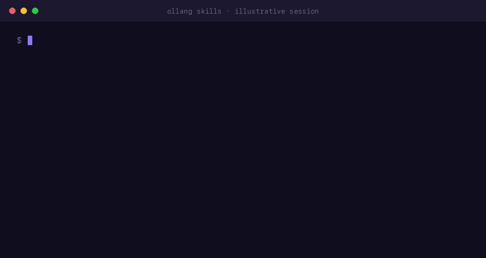
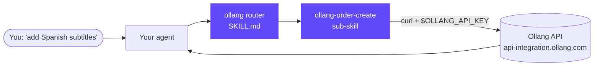
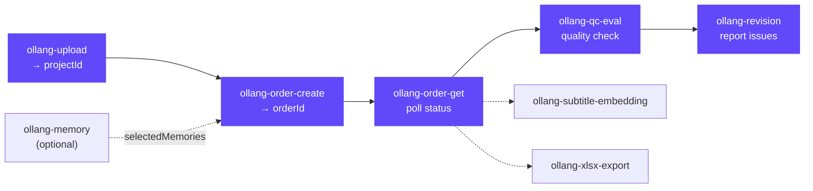

<div align="center">

<picture>
  <source media="(prefers-color-scheme: dark)" srcset="assets/ollang-logo-dark.svg">
  
</picture>

### Agent Skills for the Ollang API

Upload, translate, caption, dub, review, and export content from your AI agent, in plain language.

[](#-available-skills)
[](#-quick-start)
[](https://api-docs.ollang.com)
[](https://api-docs.ollang.com/mcp/overview)
[](https://github.com/ollang/skills/commits/main)
[](LICENSE)

**Works with** Claude Code · OpenAI Codex · Cursor · Devin · any agent that supports the skills standard

[Quick start](#-quick-start) · [Skills](#-available-skills) · [How it works](#-how-it-works) · [Security](#-authentication--security) · [Docs](https://api-docs.ollang.com)

</div>

<br>

<p align="center">
  
</p>
<p align="center"><sub>Illustrative session. IDs are placeholders; orders process asynchronously after they are submitted.</sub></p>

## ⚡ Quick start

**1. Install the skills**

```bash
npx skills add https://github.com/ollang/skills --skill ollang
```

This adds the `ollang` router skill and its sub-skills to your agent.

<details>
<summary>Manual installation</summary>

Copy the skill folders into your agent's skills directory (for example `~/.claude/skills/` for Claude Code). For Cursor or other agents, see your agent's documentation.

</details>

**2. Set your API key** (get one at [lab.ollang.com](https://lab.ollang.com))

```bash
export OLLANG_API_KEY=<your-api-key>
```

Run this in your own terminal, or add it to your shell profile or your project's `.env`. Only `ollang-health` works without a key.

**3. Ask your agent**

```text
Upload ./intro.mp4 to Ollang and add Spanish subtitles
Check the status of my recent orders
Run a quality check on order <order-id>
```

## 🧰 Available skills

Skills trigger automatically from what you ask. The root [`SKILL.md`](SKILL.md) routes each request to the sub-skill below that owns it.

#### 📁 Files and projects

| Skill | What it does |
|---|---|
| [`ollang-upload`](ollang-upload/SKILL.md) | Direct file upload + VTT upload<br><sub>💬 "upload this file to Ollang" · "create a project"</sub> |
| [`ollang-project`](ollang-project/SKILL.md) | Browse and inspect projects<br><sub>💬 "list my projects" · "get project details"</sub> |
| [`ollang-folder`](ollang-folder/SKILL.md) | Browse folders + batch translator assignment<br><sub>💬 "list my folders" · "assign translator to folder orders"</sub> |

#### 🎬 Orders

| Skill | What it does |
|---|---|
| [`ollang-order-create`](ollang-order-create/SKILL.md) | Create CC, subtitle, document, or dubbing orders<br><sub>💬 "create a subtitle order" · "translate this to Spanish"</sub> |
| [`ollang-order-get`](ollang-order-get/SKILL.md) | Get a single order by ID<br><sub>💬 "check order status" · "get order details"</sub> |
| [`ollang-orders-list`](ollang-orders-list/SKILL.md) | Paginated order list with filters<br><sub>💬 "list my orders" · "show recent translations"</sub> |
| [`ollang-order-cancel`](ollang-order-cancel/SKILL.md) | Cancel an active order<br><sub>💬 "cancel order" · "stop this translation"</sub> |
| [`ollang-order-rerun`](ollang-order-rerun/SKILL.md) | Reprocess with latest AI models<br><sub>💬 "rerun order" · "regenerate translation"</sub> |

#### ✅ Quality and review

| Skill | What it does |
|---|---|
| [`ollang-qc-eval`](ollang-qc-eval/SKILL.md) | AI quality scores (accuracy, fluency, tone, cultural fit)<br><sub>💬 "run QC" · "evaluate translation quality"</sub> |
| [`ollang-human-review`](ollang-human-review/SKILL.md) | Upgrade/downgrade to linguist review<br><sub>💬 "request human review" · "cancel human review"</sub> |
| [`ollang-revision`](ollang-revision/SKILL.md) | Create, list, delete revisions<br><sub>💬 "report subtitle error" · "create a revision"</sub> |

#### 🧠 Language assets

| Skill | What it does |
|---|---|
| [`ollang-memory`](ollang-memory/SKILL.md) | Manage translation memories + async item imports<br><sub>💬 "create a translation memory" · "import TM entries"</sub> |
| [`ollang-custom-instructions`](ollang-custom-instructions/SKILL.md) | CRUD operations for custom translation instructions<br><sub>💬 "create a custom instruction" · "manage translation rules"</sub> |
| [`ollang-content`](ollang-content/SKILL.md) | Content database export/import (i18n key-value pairs)<br><sub>💬 "export my translations as JSON" · "import locale strings"</sub> |

#### 📦 Deliverables and integrations

| Skill | What it does |
|---|---|
| [`ollang-subtitle-embedding`](ollang-subtitle-embedding/SKILL.md) | Request subtitle embedding for an order<br><sub>💬 "burn in subtitles" · "hardcode subtitles into the video"</sub> |
| [`ollang-xlsx-export`](ollang-xlsx-export/SKILL.md) | Single-order and bulk-folder XLSX exports<br><sub>💬 "export order as Excel" · "spreadsheet of folder translations"</sub> |
| [`ollang-figma`](ollang-figma/SKILL.md) | Figma import + translation orders (requires Figma OAuth connection)<br><sub>💬 "translate this Figma file" · "status of my Figma orders"</sub> |

#### 📊 Account and status

| Skill | What it does |
|---|---|
| [`ollang-health`](ollang-health/SKILL.md) | Health check — no auth required<br><sub>💬 "is Ollang up?" · "check API status"</sub> |
| [`ollang-credits`](ollang-credits/SKILL.md) | Credit wallet + consumption line items (billing roles only)<br><sub>💬 "what's my credit balance?" · "show consumption breakdown"</sub> |

## 🔍 How it works

Skills are prompt-based extensions: no server to run and nothing to deploy. Your agent reads the skill that matches your request and calls the Ollang API with `curl`, reading the key from `$OLLANG_API_KEY`.



### Typical workflow



Optional: prepare translation memories up front (`ollang-memory`), then pass them via `selectedMemories` when creating orders. After completion, burn subtitles into the video (`ollang-subtitle-embedding`) or export segments as XLSX (`ollang-xlsx-export`).

## 🔐 Authentication & security

All skills (except `ollang-health`) require an API key from [lab.ollang.com](https://lab.ollang.com), provided through the `OLLANG_API_KEY` environment variable.

> [!IMPORTANT]
> Never paste your API key into the agent conversation — chat transcripts may be stored or shared. The skills are designed to read the key only from the environment variable and to pass it via shell expansion (`$OLLANG_API_KEY`), so its value never appears in the conversation, logs, or files.

> [!TIP]
> If a key does end up in a chat, rotate it at [lab.ollang.com](https://lab.ollang.com).

## 📝 Notes

- **API base URL:** all requests go to `https://api-integration.ollang.com`.
- Query params using bracket notation (e.g. `pageOptions[page]`) require curl's `-g` flag (`--globoff`) to prevent URL malformat errors. All skills handle this automatically.
- Skills are compatible with any agent that supports the skills standard (Claude Code, OpenAI Codex, Cursor, Devin, etc.).

## 🔗 More ways to integrate

| | |
|---|---|
| 📚 **API docs** | [api-docs.ollang.com](https://api-docs.ollang.com) |
| 🤖 **MCP server** | [Hosted MCP for Claude, Cursor, and more](https://api-docs.ollang.com/mcp/overview) |
| 🧩 **SDKs** | [Node, Python, and Java](https://api-docs.ollang.com/sdk/overview) |
| 📖 **Skills guide** | [Skills on the docs site](https://api-docs.ollang.com/skills/overview) |

## 🤝 Contributing

Each `ollang-*/SKILL.md` owns one operation, and the root [`SKILL.md`](SKILL.md) routes to it. When you add a skill, update the router and this README together, and check request examples against the [API docs](https://api-docs.ollang.com). See [`AGENTS.md`](AGENTS.md) for the full guidelines.

## 📄 License

[MIT](LICENSE) © Ollang Inc. The license covers the code and documentation in this repository; the Ollang name and logo are not licensed under it.

<div align="center">
<br>
<sub>Built by <a href="https://ollang.com">Ollang</a> · AI Language Execution Layer for Enterprise</sub>
</div>
